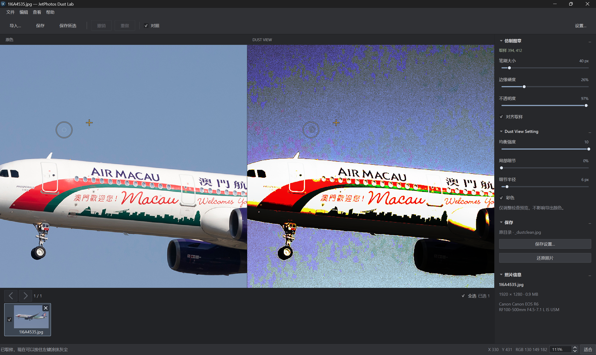

> [!TIP]
> **🌐 [点击使用网页版](https://jiananlan.github.io/Jetphotos_Dust_lab/)**

背景简介： 航空摄影的一些场景中，天空面积较大、纹理较少，镜头或 CMOS 上的灰尘脏点即使直接观看不明显，JetPhotos 等图库对此仍有严格的要求。其内置的“Check for Dust”工具可以让这些脏点清晰显示出来，但检查和修改往往需要反复上传、查看，再回到修图软件处理，非常不便。

JetPhotos Dust Lab 是一款面向图库航空摄影的灰尘检查与手动修复工具，将 Dust 预览、原色对比、仿制修复和导出整合在一处，方便摄影师在整理或投稿前完成照片检查。

**Features：**

- **Dust 预览：** 模拟复现各大图库的“Check for Dust”工具，突出天空中的微弱灰尘斑点。
- **双视图同步修复：** 原照片与 Dust 预览并排显示，两侧均可取样和涂抹，缩放、平移与修复结果同步更新。
- **仿制修复图章：** 支持笔刷大小、硬度、不透明度和对齐取样，配合取样位置提示，方便精细修复。
- **多图管理、批量导出：** 支持多图导入、拖放和缩略图切换，各张照片独立保留编辑状态与撤销记录，可勾选后批量保存。
- **100%质量JPG输出：** 保留原始尺寸，符合各大网站无压缩要求。
- **EXIF数据保留：** 原样保留EXIF、XMP、ICC等数据段，方便日后查看复盘。
- **版本：** 提供 Windows 桌面版和网页版。

